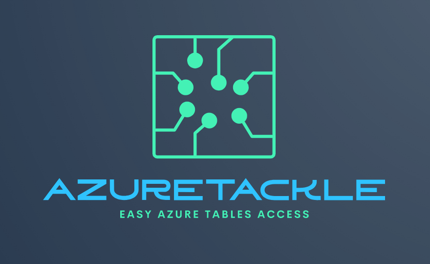

# AzureTackle

Functional F# wrapper around the Azure.Data.Tables SDK for Azure Table Storage. `AzureTackle` provides a fluent, pipeline-based API for table operations with F# functional programming patterns.

## Available Packages

| Library  | Version |
| ------------- | ------------- |
| AzureTackle  | [](https://www.nuget.org/packages/AzureTackle/) |

## Install

```bash
# nuget client
dotnet add package AzureTackle

# or using paket
paket add AzureTackle --project path/to/project.fsproj
```

## Query a table

```fsharp
open AzureTackle

type TestData = {
    PartKey: string
    RowKey: string
    Date: DateTimeOffset
    Exists: bool
    Value: float
    Text: string
}

let! values =
    AzureTable.withConnectionString ("UseDevelopmentStorage=true", "MyTable")
    |> AzureTable.execute (fun entity ->
        {
            PartKey = entity.PartitionKey
            RowKey = entity.RowKey
            Date = entity.ReadDateTimeOffset "Date"
            Exists = entity.ReadBoolean "Exists"
            Value = entity.ReadDouble "Value"
            Text = entity.ReadString "Text"
        })
```

## Query with filter

```fsharp
open AzureTackle

let! values =
    AzureTable.withConnectionString ("UseDevelopmentStorage=true", "MyTable")
    |> AzureTable.filter (PartKey "myPartition" + RowKey "myRow")
    |> AzureTable.execute (fun entity ->
        {
            PartKey = entity.PartitionKey
            RowKey = entity.RowKey
            Date = entity.ReadDateTimeOffset "Date"
            Exists = entity.ReadBoolean "Exists"
            Value = entity.ReadDouble "Value"
            Text = entity.ReadString "Text"
        })
```

## Filter DSL

AzureTackle provides a composable filter DSL with operators:

```fsharp
// AND operator (+)
let andFilter = PartKey "pk" + RowKey "rk"

// OR operator (*)
let orFilter = PartKey "pk1" * PartKey "pk2"

// NOT operator (!!)
let notFilter = !! (RowKey "excluded")

// Comparison functions
let eq = Equal "Status" "active"
let neq = NOT "Status" "deleted"
let gt = GreaterThan "Age" 18
let lt = LessThan "Price" 100.0
let gte = GreaterThanOrEqual "Count" 5
let lte = LessThanOrEqual "Score" 100

// Complex combinations
let complex =
    (PartKey "users" + Equal "Status" "active")
    * (PartKey "admins" + Equal "Status" "active")
```

## Insert or update data (Upsert)

```fsharp
open AzureTackle
open Azure.Data.Tables

// Using fluent Append API
let entity =
    TableEntity("myPartition", "myRow")
        .Append("Date", DateTimeOffset.UtcNow)
        .Append("Value", 0.5)
        .Append("Exists", true)
        .Append("Text", "Hello World")
        .AppendOptional("OptionalField", Some "value")

do! AzureTable.withConnectionString ("UseDevelopmentStorage=true", "MyTable")
    |> AzureTable.upsert entity
```

## Inline upsert

```fsharp
do! AzureTable.withConnectionString ("UseDevelopmentStorage=true", "MyTable")
    |> AzureTable.upsertInline ("myPartition", "myRow") (fun entity ->
        entity
            .Append("Date", DateTimeOffset.UtcNow)
            .Append("Value", 0.5)
            .Append("Exists", true)
            .Append("Text", "Hello World"))
```

## Batch upsert

```fsharp
let entities = [|
    TableEntity("pk1", "rk1").Append("Value", 1)
    TableEntity("pk1", "rk2").Append("Value", 2)
    TableEntity("pk1", "rk3").Append("Value", 3)
|]

do! AzureTable.withConnectionString ("UseDevelopmentStorage=true", "MyTable")
    |> AzureTable.upsertBatch entities
```

## Delete entity

```fsharp
do! AzureTable.withConnectionString ("UseDevelopmentStorage=true", "MyTable")
    |> AzureTable.delete ("partKey", "rowKey")
```

## Batch delete

```fsharp
let itemsToDelete = [| "rk1"; "rk2"; "rk3" |]

do! AzureTable.withConnectionString ("UseDevelopmentStorage=true", "MyTable")
    |> AzureTable.deleteBatch itemsToDelete (fun rk -> TableEntity("pk", rk))
```

## Available Read methods

| Method | Return Type |
| ------ | ----------- |
| `ReadString` | `string` |
| `ReadBoolean` | `bool` |
| `ReadInt` | `int` |
| `ReadBigInt` | `int64` |
| `ReadDouble` | `float` |
| `ReadDecimal` | `decimal` |
| `ReadDateTime` | `DateTime` |
| `ReadDateTimeOffset` | `DateTimeOffset` |
| `ReadGuid` | `Guid` |
| `ReadBinary` | `byte[]` |
| `ReadOptionalString` | `string option` |
| `ReadOptionalBoolean` | `bool option` |
| `ReadOptionalInt` | `int option` |
| `ReadOptionalDouble` | `float option` |
| `ReadOptionalDateTimeOffset` | `DateTimeOffset option` |
| `ReadOptionalGuid` | `Guid option` |
| `ReadStringOrEmpty` | `string` (empty if null) |
| `ReadBoolOrDefault` | `bool` (false if null) |
| `ReadIntOrDefault` | `int` (0 if null) |
| `ReadDoubleOrDefault` | `float` (0.0 if null) |

## Using TableServiceClient

```fsharp
let tableServiceClient = TableServiceClient("UseDevelopmentStorage=true")

let! values =
    AzureTable.withTableClient (tableServiceClient, "MyTable")
    |> AzureTable.execute (fun entity ->
        { PartKey = entity.PartitionKey
          RowKey = entity.RowKey
          Text = entity.ReadString "Text" })
```

## Pagination

```fsharp
// Get only the first 2 pages of results
let! values =
    AzureTable.withConnectionString ("UseDevelopmentStorage=true", "MyTable")
    |> AzureTable.executeFirstPages 2 (fun entity ->
        { PartKey = entity.PartitionKey
          RowKey = entity.RowKey })
```

## SortedRowKey

Create sortable row keys from DateTime (newer entries sort first):

```fsharp
open AzureTackle.Shared

let rowKey = SortedRowKey.toSortedRowKey DateTime.UtcNow
// Uses inverted ticks: DateTime.MaxValue.Ticks - dateTime.Ticks
```
